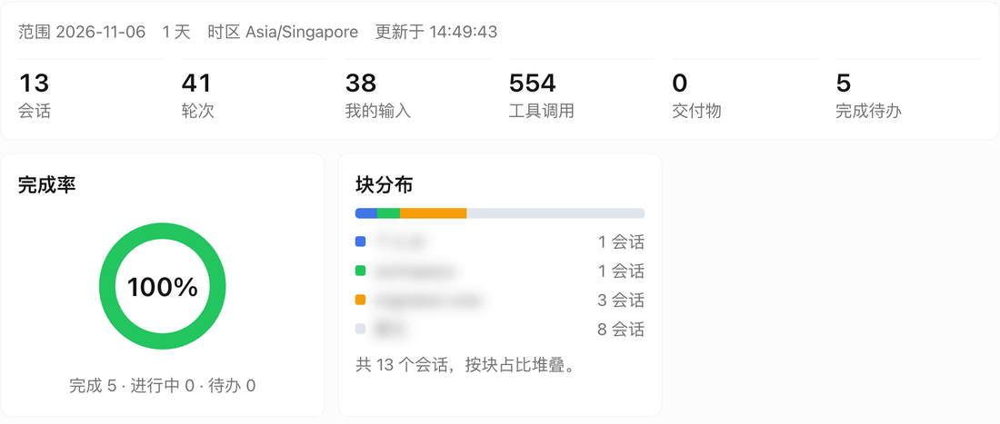
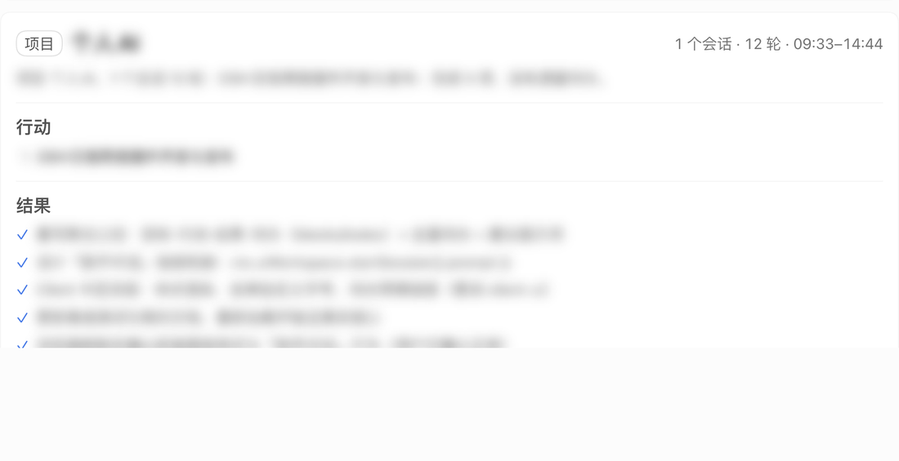
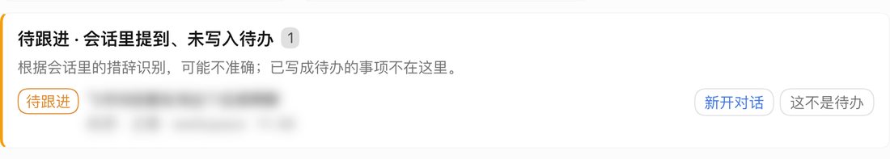

# dsh-ai-journal · AI 日报

[](https://www.npmjs.com/package/dsh-ai-journal)
[](LICENSE)
[](https://github.com/deepseek-ai/deepseek-harness)
[](https://github.com/vc1235-ui/dsh-ai-journal/actions/workflows/test.yml)

用你本机的 DSH 会话日志，自动生成**每日 / 每周 AI 日报**：今天/本周做了什么、归属哪个目标、结果和交付物是什么、还有哪些没完成。在 DSH 左侧栏提供入口，面板按「目标 → 行动 → 结果 → 待办」分块展示，顶部是图形化摘要。

> 数据只来自本机 DSH 的会话日志，不联网、不上传。唯一落盘的是你点「这不是待办」后产生的忽略列表。

**English:** dsh-ai-journal turns your local DeepSeek Harness session logs into a daily/weekly report panel in the DSH Web sidebar — activities grouped by goal/project, results with deliverable links, all unfinished todos with one-click "open a new chat with a suggested prompt", plus a graphical summary. Local-only: no network, no uploads.

---

## 面板内容

- **概览**：KPI 大数字（会话 / 轮次 / 我的输入 / 工具调用 / 交付物 / 完成待办）+ 范围、时区、更新时间。
- **图形化摘要**：待办完成率环、目标/项目分布堆叠条、周报额外有 7 天轮次柱状图（柱 hover 显示数值）。
- **按目标分块**（没有目标的会话按项目归组）：
  - **行动**：窗口内的人类输入摘要，按时间排序；
  - **结果**：完成项、交付物（可点击，在宿主桌面打开原文件）、完成的待办；
  - **待办**：该块所有未完成事项（`pending` + `in_progress`）+ 进行中/受阻的目标，每条右侧有「新开对话」，预填针对性的提示词。
- **待跟进**（可选）：从会话里人类输入的措辞（「后续再聊」「待回复」「待确认」等）**启发式**识别出可能被口头遗留的事项，单独成区、明确标注不确定；每条可以「新开对话」或点「这不是待办」忽略（可撤销）。
- **日报 / 周报**切换，日期前后翻页，手动刷新。

## 截图

> 会话标题、项目名与具体内容已做模糊打码。







## 安装

需要 DSH Web（验证版本 `0.2.1-rc.5`）与可用的会话查询服务。

```sh
# 从 npm（推荐，发布后可用）
dsh plugin --profile web add dsh-ai-journal

# 或直接从 GitHub 安装
dsh plugin --profile web add https://github.com/vc1235-ui/dsh-ai-journal

# 或本地路径
dsh plugin --profile web add /path/to/dsh-ai-journal
```

安装后在 DSH 里启用插件并重启（或等 HMR 生效），左侧栏会出现「AI 日报」入口。

## 统计口径

- **窗口**：日报 = 请求时区当天 `00:00` 起；周报 = 当周周一 `00:00` 起，7 天。
- **做了什么**：窗口内有活动的会话（`blank`、subagent 会话除外）与窗口内的人类输入；没有人类输入时回退到窗口前最后一次输入。
- **归属目标**：会话最新 `goal/change` 的 objective；没有目标按项目（cwd）归组。
- **未完成**：会话最新 `todo/write` 快照里的 `pending` / `in_progress`，加上 `active` / `blocked` 的目标。
- **交付物**：会话事件 `deliverables/presented` 里的文件；点击走宿主认证的 `POST /api/present.open`，在桌面打开。
- **待跟进**：只扫窗口内人类输入，命中固定措辞集合，每会话 ≤4 条、整份 ≤12 条、同句去重；不判断是否真的未完成，因此界面标注「可能不准确」。
- 结果为空时不编造内容。精确数字由程序从会话事件统计，不经过模型改写。

## 隐私与安全

- Host 接口先过宿主认证：每个请求交给 `connection.requestRejection(request)`（Host/Origin fence + 浏览器登录 cookie），未登录 401、跨站 403、认证服务缺失时 fail closed；再由接口自身拒绝非 GET 405；
- 会话内容只在内存里聚合，不落盘、不联网、不上传；
- 唯一写接口是「这不是待办」：`POST /ai-journal/api/followups`，只把 `key / 会话 id / 截断文案 / 时间` 写到 `$DSH_HOME/ai-journal/followups-dismissed.json`（最多 5000 条）；
- 不读取飞书 Bot、IM、记忆插件等任何其它插件的存储或配置（Bot 会话在本机只是普通 DSH 会话，因此无需 bot 依赖）。

## 兼容性

- **不依赖任何第三方插件**，只用 DSH 核心服务：`sessionController` / `sessionQuery`（数据）、`webServer`（路由）、`slots` / `uiWorkspace` / `workspaces`（前端）；
- 缺会话服务时接口返回 503、面板显示中文提示，不会崩溃；
- 依赖的事件：`todo/write`、`goal/change`、`deliverables/presented`、`user/message`；未知事件一律忽略；
- 界面不声明字体与绝对字号（KPI 数字用相对 `em`），跟随 DSH 全局字号与主题；
- 交付物打开依赖 DSH Web 自带的 `/api/present.open`（`@deepseek-ai/dsh-web-app` 内置），缺失时点击提示失败，报告其余部分正常。

## 开发

```sh
node --check index.js && node --check client.js
node --test test/journal.test.mjs      # 聚合层 22 项
node --test test/dismissed.test.mjs    # 忽略存储 3 项
node test/client.test.cjs              # 面板渲染 80 项（vm + mock）
```

目录：`index.js`（Host 路由与取数）、`lib/journal.js`（纯聚合）、`lib/dismissed.js`（忽略记录）、`lib/auth.js`（宿主认证 fence）、`client.js`（浏览器面板）、`API-CONTRACT.md`（接口契约）、`test/`（离线测试）。

真实接口自检（需运行中的 Web，认证用启动时打印的 `?token=`）：

```sh
node scripts/verify.mjs --url http://127.0.0.1:3080 --token <launch-token>
```

## 市场收录

- npm：[`dsh-ai-journal@0.1.1`](https://www.npmjs.com/package/dsh-ai-journal) ✅
- 开放插件市场（dshopen.org）：收录申请已提交（[#283](https://github.com/polang233/dsh-plugin-index/issues/283)）⏳
- DSH 社区插件市场（awesome-dsh-plugin 镜像）：待仓库满 24h 后提交 PR ⏳

完整流程见 [PUBLISHING.md](PUBLISHING.md)。

## License

[MIT](LICENSE)
